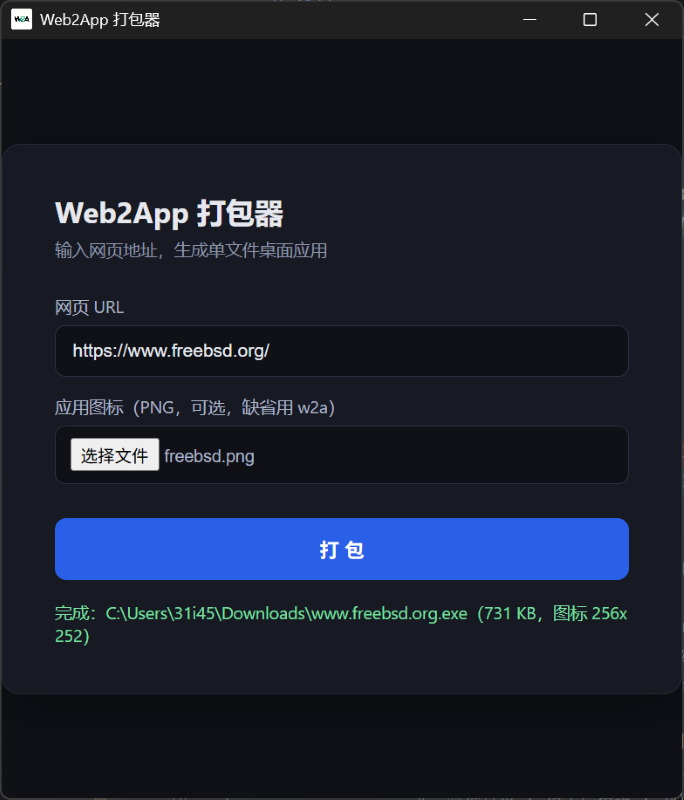
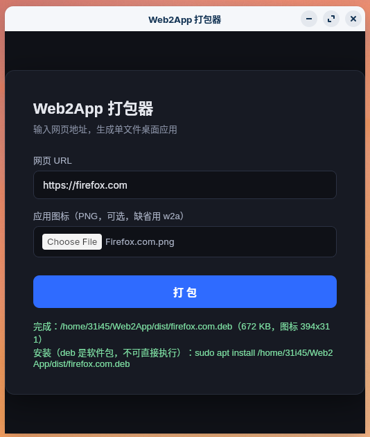

# Web2App

<p align="center">
  
</p>

<h3 align="center">一个 URL，变成一个原生桌面应用</h3>

<p align="center">
  输入网页地址（可选自定义图标）→ 得到可分发的桌面产物。<br>
  调用系统自带 WebView，零内嵌浏览器引擎，Windows 单文件 <code>.exe</code>，Linux 原生 <code>.deb</code>。
</p>

<p align="center">
  <a href="https://github.com/31i45/Web2App/actions/workflows/ci.yml"></a>
  <a href="https://github.com/31i45/Web2App/releases/latest"></a>
  <a href="https://github.com/31i45/Web2App/releases"></a>
  <a href="https://github.com/31i45/Web2App/stargazers"></a>
  <a href="https://github.com/31i45/Web2App/forks"></a>
  <a href="https://github.com/31i45/Web2App/issues"></a>
  <a href="LICENSE"></a>
  
  
</p>

<p align="center">
  <b><a href="#-下载">下载</a></b> ·
  <b><a href="#-快速开始">快速开始</a></b> ·
  <b><a href="#-架构">架构</a></b> ·
  <b><a href="#-质量指标与-ci-门禁">质量与 CI</a></b> ·
  <b><a href="#-从源码构建">源码构建</a></b>
</p>

| Windows | Linux |
|---|---|
|  |  |

---

## 这是什么

Web2App 是一个 **Web → 桌面应用打包器**：把常用网页（管理后台、内部系统、SaaS、OAuth 登录站……）包装成有独立窗口、自定义图标、独立 profile 的桌面应用，而不是浏览器里的一个标签页。

产物运行时复用系统自带的浏览器内核（Windows 为 WebView2，Linux 为 WebKitGTK），页面里的 JS、登录态、接口调用与浏览器完全一致；**是否可离线使用取决于网站自身是否具备缓存/Service Worker，壳不缓存任何业务资源**。

设计受 [Pake](https://github.com/tw93/Pake) 与小暖科技 SiteNative 启发，但架构选择不同：不依赖 Node/CLI 工具链，**一个 GUI 打包器单文件离线产出**（详见[架构](#-架构)）。

## 适合 / 不适合

- 适合：给网页一个独立入口与品牌外壳；内部分发业务系统桌面端；国产桌面 OS（deepin/UOS/openKylin/麒麟及 Ubuntu/Debian 全系）上交付轻量 Web 客户端。
- 不适合：需要调用原生能力（托盘、全局快捷键、文件系统深度集成）的重型原生应用；需要内置离线资源包的场景；macOS 平台（暂无真机，见[平台策略](#平台策略)）。

## ⬇ 下载

打包器（master）本身 **双平台均为裸可执行文件，下载即用，无需安装**；产物落盘在打包器所在目录，放哪用哪。

| 平台 | 文件 | 要求 |
|---|---|---|
| Windows x86_64 | [web2app-v\*-x86_64-pc-windows-msvc.exe](https://github.com/31i45/Web2App/releases/latest) | WebView2 Runtime（Win11 自带，Win10 一般已预装） |
| Linux x86_64 | [web2app-v\*-x86_64-unknown-linux-gnu](https://github.com/31i45/Web2App/releases/latest) | WebKitGTK 4.1 / GTK 3（glibc ≥ 2.35，构建基线 ubuntu-22.04） |

每个 Release 均附 `SHA256SUMS.txt`（CI 生成，覆盖全部产物）：

```powershell
# Windows PowerShell
Get-FileHash .\web2app-v*-x86_64-pc-windows-msvc.exe -Algorithm SHA256
```

```bash
# Linux
sha256sum -c SHA256SUMS.txt --ignore-missing
```

## 🚀 快速开始

**Windows**

```powershell
.\web2app.exe   # 或从 Releases 下载后直接双击
```

**Linux**

```bash
chmod +x web2app-v*-x86_64-unknown-linux-gnu
./web2app-v*-x86_64-unknown-linux-gnu
```

界面只有三元素：**网页 URL 输入框、图标选择（可选）、打包按钮**（回车等同提交）。点击打包后，产物生成在打包器所在目录，文件名取 URL host：

- Windows → `example.com.exe`（单文件，双击即用）
- Linux → `example.com.deb`（`sudo apt install ./example.com.deb`，卸载 `sudo apt remove example.com`，包名与文件名同名）

图标选择走浏览器原生 `input[type=file]` + `FileReader`，图片字节经 IPC 传入原生层，**不依赖文件绝对路径**，换机器/换目录不影响打包。

**无头 / CI 打包模式**（端到端测试即使用该模式）：

```bash
web2app --pack <url> [--icon <icon.png>] [--out <产物路径>]
```

## 使用生成的产物

**Windows**：直接双击运行。Explorer 文件列表、标题栏、任务栏均显示自定义图标（未提供图标时显示 w2a 默认图标）；exe 所在目录零落盘，数据在独立 profile 目录。未签名产物首次运行 SmartScreen 会提示「Windows 已保护你的电脑」，「更多信息」→「仍要运行」即可（见[代码签名](#代码签名可选)）。

**Linux**：`.deb` 安装后应用菜单出现启动项（含图标），也可终端直接输入 `<host>` 启动；数据目录遵循 XDG，与系统浏览器及其他 Web2App 应用互相隔离。

## 🧠 架构

三 crate workspace 服务于一条硬约束：**用户产物单文件、极致轻量**。

```
.
├── tail-core/            # 纯逻辑层（零 OS 依赖，可任意宿主单测）
│   └── src/              #   lib.rs 纯 re-export；tail.rs 尾部协议 + JSON 转义 · CRC32；
│                         #   text.rs JS 字面量 · base64；image.rs PNG 解码/缩放；url.rs URL 工具
├── child/                # 子应用运行时（用户分发的精简产物，约 700 KiB）
│   ├── build.rs          #   winres 将 w2a.ico 编译进 .rsrc（仅 Windows 目标生效）
│   └── src/
│       ├── main.rs       #   读尾部配置 → 开 WebView；无配置 → 致命错误退出（裸模板不可运行）
│       ├── icon.rs       #   PNG → tao 窗口图标（tail_core::decode_png）
│       ├── popup.rs      #   新窗口四向分流（纯逻辑，零 OS 依赖）
│       ├── webview.rs    #   WebView 构建 + 脚本注入 + 全部宿主能力接线
│       └── platform/     #   #[cfg] 同名同签名平台外壳（mod/windows.rs/linux.rs，非 trait）
├── master/               # 打包器（产物名 web2app，编译期内嵌 child 模板）
│   ├── build.rs          #   自 OUT_DIR 上溯定位 child 二进制（兼容 --target）→ include_bytes! 内嵌
│   └── src/
│       ├── main.rs       #   GUI 表单调度 + --pack 无头打包入口
│       ├── ui.rs         #   内嵌 HTML 表单 + IPC 解析
│       ├── builder.rs    #   打包编排：模板 → 注入图标 → 追加尾部 →（可选）签名
│       ├── tail_write.rs #   尾部写入（写尾能力隔离于此，child 依赖图中物理不存在）
│       ├── winicon.rs    #   PNG→ICO + UpdateResource 注入 .rsrc（仅 Windows）
│       ├── sign.rs       #   可选 signtool 签名 hook（仅 Windows）
│       ├── icon.rs       #   母版窗口图标（与 child 同构，不依赖 child crate）
│       └── platform/     #   数据目录 / 路径规范化 / 打包平台项 / 关闭兜底 / 致命错误
├── assets/               # w2a.ico · logo_256.png · 双平台截图
├── docs/                 # 跨平台设计文档与平台 seam 笔记
├── GLOSSARY.md           # 术语表（文档与代码注释的统一口径）
├── audit.ps1             # 依赖边界审计：标记扫描 / PE·ELF 映像计数 / cargo tree 边界
├── build.ps1 / build.sh  # 一键构建（child → 测试 → clippy → master → 装配）
└── e2e.ps1 / e2e.sh      # 端到端门禁（Windows 30 项 / Linux 37 项断言）
```

### 为什么是两个二进制

- **child**：精简运行时，即用户分发的产物。它不含任何打包器代码——**写尾能力 `tail_write` 物理隔离在 master crate 内，child 的依赖图里不存在写尾代码，无法通过补丁、删命令行参数等方式获得「再打包」能力**。这是编译期结构性保证，不依赖 release 优化器剔除。
- **master（web2app）**：打包器，编译期 `include_bytes!(env!("CHILD_BIN_PATH"))` 内嵌 child 模板。填表 → 打包 → 输出的每一个字节都源自 child，与 master 自身二进制无关（e2e 中有字节级一致性断言）。

两者仅经 `tail-core` 共享尾部协议、PNG/URL 工具。`audit.ps1` 在 CI 中机械守护该边界：敏感字符串标记扫描 + PE/ELF 映像计数 + `cargo tree` 依赖断言。

裸 child 模板不可直接运行：读不到尾部配置即弹致命错误并以退出码 1 退出，不启动任何 WebView。

### 尾部协议

产物 = child 模板 + 尾部配置帧，配置 JSON 内含起始 URL、品牌标题与窗口图标 PNG（base64）：

```
<payload JSON> <MAGIC:16B "__WEB2APP_TAIL__"> <len:u64 LE> <ver:u8> <crc32:u32 LE>
```

- v3 帧尾共 **29 字节**；CRC32（IEEE 802.3）覆盖 payload + 长度 + 版本字节，尾部被截断或篡改时明确报「文件可能已损坏」，绝不静默错跑。
- 兼容读取 v2 帧（24 字节，无 CRC）；剥离旧尾按结构切片，损坏帧同样可剥，**重复打包体积稳定、不膨胀**。
- JSON 转义、base64、CRC32 全部手写，不为协议引入任何直接依赖；`serde` 不进运行时依赖图（lock 中的 serde 仅由构建期 `winres → toml` 在 host 侧带入）。

### 图标：两条通道

| 通道 | 作用位置 | 机制 |
|---|---|---|
| 文件图标 | Explorer / 文件管理器 | child 编译期由 winres 内嵌 w2a 默认图标；打包时 master 用 `UpdateResource` 把用户 PNG 转成的 ICO 注入产物 `.rsrc` 节，产物仍是单文件 |
| 窗口图标 | 标题栏 / 任务栏 | 用户 PNG 随尾部配置内嵌，运行时经 tao `with_window_icon` 设置；未提供则回落编译期 `include_bytes!` 的 w2a 默认图 |

> Windows 窗口类图标**不会**自动回落 exe 的 .rsrc 资源，未显式设置时显示系统默认图标——因此「用户未选图」也必须主动设置内嵌默认图，这是实测确认的行为而非推测。

### 打包顺序（Windows）

1. child 模板写入临时文件；
2. `UpdateResource` 注入用户图标改写 PE `.rsrc`（必须先于写尾，否则尾部会被 `EndUpdateResource` 丢弃）；
3. 追加尾部配置帧（含窗口图标 PNG）；
4. 原子 rename 为最终产物；
5. 可选签名（失败仅警告，不阻塞）。

Linux 侧对应链路为组装 `.deb`（`/usr/bin/<host>` ELF + `.desktop` + hicolor 256px 图标 + `doc/copyright`），无 PE 资源改写步骤。

### 关闭的确定性

实测（tao 0.37 + wry 0.57 / WebView2）：单条 `WM_CLOSE` 路径（Alt+F4、任务栏关窗、`taskkill` 无 `/F`、UI 自动化）下，tao 的 `CloseRequested` 可能永不派发——消息被 WebView2 嵌套 COM 消息泵吞没，进程 30s+ 不自退。两层兜底：

- **WNDPROC 哨兵**（`install_close_watchdog`，WebView 构建前安装）：`WM_CLOSE` 在进入框架前被捕获，武装看门狗后无条件透传原窗口过程，事件链无损；
- **看门狗线程**（`quit_watchdog`）：独立线程睡眠 **300 ms** 后 `process::exit(0)`，绕开消息泵竞争，给出确定退出上限。

「关闭即退出、零残留」不靠运气：e2e 对主窗口、弹窗、master 自身均断言无宿主/WebView 子进程残留。

### Profile 隔离

数据目录为 `<数据根>/Web2App/apps/<host>_<URL 指纹>`（Windows 即 `%LOCALAPPDATA%`，Linux 遵循 XDG）：同一 host 下不同应用的 cookie/存储/缓存互不污染，同一 URL 重复打包共享同一 profile；exe 所在目录零落盘（Linux 亦不泄漏默认 webkitgtk 目录，e2e 有断言）。

### 宿主侧能力补齐

wry 默认关闭了一批 WebView2/WebKitGTK 原生特性，产物按「桌面浏览器等效体验」逐项补齐，零新增运行时 crate：

| 能力 | 背景与实现 |
|---|---|
| 新窗口路由 | `target=_blank` / `window.open` 默认被静默丢弃（部分站点「链接点了没反应」的根因）。`classify_new_window` 四向分流：**弹窗**（无 URL 的 `window.open()` 或带尺寸/位置特征）在应用内新建独立原生窗，共享发起方 WebView2 环境，OAuth 会话得以延续；**同站**（含互为子域）就地导航；**跨站**普通链接交系统默认浏览器；`blob:`/`data:`/`javascript:` 等内部伪协议忽略 |
| HTML5 真全屏 | 注入脚本监听 `fullscreenchange` 上报，宿主调 `set_fullscreen`；弹窗对等支持（Win32 切换窗口样式）。WebView 内部全屏只填满 webview，不是窗口真全屏 |
| 导航与缩放 | `with_hotkeys_zoom` 缩放、`with_back_forward_navigation_gestures` 触摸板横扫；Alt+←/→、鼠标侧键等 WebView2 浏览器快捷键保持默认，历史栈完整可连续回退 |
| 回首页 | **Alt+Home** 双层送达：页面层 `keydown`（含判定、BFCache 回跳、在途守卫）+ 宿主层 `AcceleratorKeyPressed`（`webview2-com` 直连，焦点在跨源 iframe 内时兜底），200 ms 时间戳去重；历史中命中首页条目走 Navigation API `traverseTo`（BFCache 瞬时生效），否则整页导航；主窗口与弹窗共用同一首页 |
| 剪贴板 | `with_clipboard(true)`（默认关闭）。**已知边界**：wry 权限回调不携带请求 origin，只能全局放行或全局关闭，为不牺牲「粘贴」类交互选择全局放行 |
| 下载 | 保持 WebView2 原生下载面板与落点（注册处理器反而会关掉原生面板），仅在页面内补一条完成/失败轻提示 |
| 标题同步 | `document.title` 回流主循环：主窗口保留品牌标题，弹窗跟随文档标题 |
| `window.close` 守卫 | 页面对顶层窗口的 `window.close()` 降级为无操作（对齐浏览器对「非脚本打开的顶层窗」语义）；弹窗的 `window.close()` 正常关窗 |
| 主题跟随 | 页面 `prefers-color-scheme` 与窗口标题栏均跟随系统深浅色 |

## 运行时要求

| 平台 | 要求 | 说明 |
|---|---|---|
| Windows | WebView2 Runtime | [官方下载](https://developer.microsoft.com/microsoft-edge/webview2/)；Win11 自带，Win10 多数已预装 |
| Windows | 代码签名 | 可选。不签名可正常运行，仅 SmartScreen 首次提示；签名后无提示 |
| Linux | 无手动步骤 | `.deb` 的 Depends 声明完整依赖链（`libwebkit2gtk-4.1-0`、`libgtk-3-0`、`gstreamer1.0-libav`、`gstreamer1.0-plugins-bad`），`apt install` 自动补齐 |

### 代码签名（可选）

签名是业务运营问题，不是架构职责。Web2App 预留干净的签名 hook（`master/src/sign.rs`）：

- 设置 `WEB2APP_SIGN_CERT`（证书路径 .pfx/.p12）后打包即自动调用 `signtool`；
- 可选 `WEB2APP_SIGN_PASS`（证书密码）、`WEB2APP_SIGN_TSA`（时间戳服务器 URL）；
- 签名失败不阻塞打包（仅警告输出）；
- **私钥永不内嵌二进制**，证书仅在打包时经环境变量传入；
- 兼容本地 signtool（Windows SDK 自带）与远程签名服务（替换 `sign.rs` 实现即可）。

## 📊 质量指标与 CI 门禁

体积数字来自 release profile 实测，随工具链漂移；**红线由 CI 机械执行，超标即失败**，不以人工自觉维持。

| 指标 | 红线 / 目标 | 当前实测 |
|---|---|---|
| child.exe（用户分发产物） | **< 1 MiB，CI 硬门禁** | 约 703 KiB（719,360 B） |
| web2app.exe（Windows 打包器） | **< 2 MiB，CI 硬门禁** | 约 1.49 MiB（CI 产物 1,560,064 B） |
| Linux `.deb`（用户分发产物） | < 1 MB | 约 430 KB（依赖系统 WebKitGTK，零内嵌引擎） |
| Linux 打包器裸 ELF | — | 约 1.85 MiB（1,944,816 B） |
| 关闭残留 | 零进程 / 零临时文件 | e2e 断言：300 ms 看门狗上限，WebView 子进程全部退出 |
| 运行副作用 | exe 目录零落盘、release 无控制台 | e2e 比对运行前后目录文件数；`windows_subsystem = "windows"` 仅 release 生效 |
| 冷启动 | 秒级 | 经验值（暂无自动化基准） |

**CI 流水线**（[.github/workflows/ci.yml](.github/workflows/ci.yml)，push/PR 全跑，`v*` 标签额外发布）：

| 阶段 | Windows（windows-latest） | Linux（ubuntu-22.04 钉版，glibc 2.35 基线） |
|---|---|---|
| 单元测试 | 84 个全绿（tail-core 42 / child 19 / master 23） | 同 84 个（平台外壳 cfg 对称，同数） |
| Lint | `clippy --all-targets -D warnings` 零告警 | 同 |
| 结构审计 | `audit.ps1`（字符串标记 / PE 映像数 / cargo tree） | ELF 分支（`\x7fELF` + 映像计数） |
| 端到端 | `e2e.ps1` 30 项断言：身份/资源元数据、产物启动、零残留、裸模板不可运行、字节级模板一致性 | `e2e.sh` 37 项断言，Xvfb 无头：按键×焦点矩阵、profile 隔离、deb 构建/安装/运行/卸载、打包中 UI 响应性 |
| 体积红线 | child ≤ 1 MiB、web2app ≤ 2 MiB | — |
| 发布 | tag 触发：双平台产物汇总 + `SHA256SUMS.txt` → GitHub Release（API 直传，失败显式报错；同名 tag 幂等重发） |

## 平台策略

| 平台 | 产物形态 | 状态 |
|---|---|---|
| Windows | 单文件 `.exe` | 主线，完整支持（WebView2 预装率高、PE + 尾部追加 = 真单文件） |
| Linux | 原生 `.deb`（Debian 系） | 完整支持：系统 WebKitGTK、`.desktop` + hicolor 图标、装/用/卸一条命令链；面向 deepin、UOS、openKylin、麒麟及 Ubuntu/Debian |
| macOS | `.app` | 暂不实现：bundle 目录与单文件承诺冲突，签名公证与窗口行为需真机验证；欢迎基于现有 `#[cfg]` 平台外壳贡献后端 |

Linux 不选择 AppImage：依赖 FUSE，而部分发行版默认禁用 FUSE。包管理器安装本就是 Linux 生态惯例，`.deb` 是 Debian 系的原生形态。

## 🛠 从源码构建

前置：Rust stable（edition 2021）。Linux 另需 `libwebkit2gtk-4.1-dev libgtk-3-dev`；跑 Linux e2e 另需 `xvfb xdotool gstreamer1.0-libav gstreamer1.0-plugins-bad dbus-x11 at-spi2-core`。

**Windows**

```powershell
.\build.ps1                                              # child → 测试 → clippy → master → 装配 dist\
.\audit.ps1                                              # 依赖边界审计
.\e2e.ps1                                                # 端到端门禁（30 项断言）
cargo test --workspace                                   # 84 个单元测试
cargo clippy --workspace --all-targets -- -D warnings    # 零告警
cargo build -p child --release                           # 单独构建 child（master 的前置）
```

**Linux（Debian 系）**

```bash
./build.sh    # 与 Windows 同门禁口径
./e2e.sh      # Xvfb 无头端到端（37 项断言）
```

两阶段构建是架构固有约束：master 编译期内嵌 child，干净 target 下必须先构建 child（脚本已处理顺序）。

**依赖构成**：`wry 0.57`（`default-features = false`，启用 `devtools`/`os-webview`/`x11`）、`tao 0.37`、`png 0.18`；Windows 运行时 `webview2-com 0.39`（宿主层 Alt+Home，版本对齐 wry 传递依赖）、`windows-sys 0.59`；Linux 运行时 `gtk 0.18`（链接系统 libgtk-3，本就由 tao/wry 传递引入，直接引用不增加依赖图节点）；构建期 `winres 0.1`（不进运行时）。release profile 全 workspace 统一 `opt-level = "z"` + `lto` + `codegen-units = 1` + `panic = "abort"` + `strip`。

## 致谢

- [Pake](https://github.com/tw93/Pake)（tw93）——让「网页打包成桌面应用」被广泛认识的优秀项目；
- [tao](https://github.com/tauri-apps/tao) / [wry](https://github.com/tauri-apps/wry) / [WebView2](https://developer.microsoft.com/microsoft-edge/webview2/) / [WebKitGTK](https://webkitgtk.org/)——本项目站立的肩膀。

## License

[MIT](LICENSE) © Web2App Contributors
